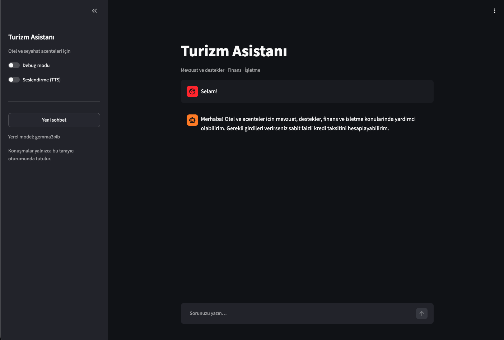
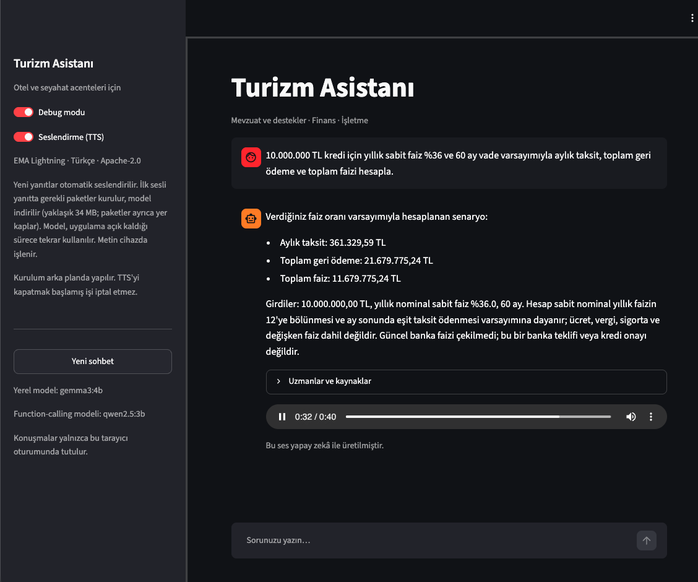

# tourism-multi-agent-rag

[English](#english) | [Türkçe](#türkçe)

## English

### 1. Purpose and scope

A Turkish-language assistant for hotels and travel agencies in Türkiye. It combines
document retrieval with three specialist roles: regulation/support, finance and
operations. It runs locally with Ollama, LangGraph and FAISS, and provides a
Streamlit chat interface plus a terminal interface.

The goal is to explain tourism-related support programs, credit guarantees,
selected tax documents and business questions in one conversation. A question
about financing may need both the conditions in a document and a qualitative
cash-flow assessment, so the supervisor can select more than one specialist.

**This project does not train or fine-tune a language model.** Documents are
converted into searchable text chunks. When a question arrives, relevant chunks
are supplied to an existing model as context. This is retrieval-augmented
generation (RAG). Adding documents requires rebuilding the index, not retraining
Gemma.

The finance specialist can select one model tool: a deterministic fixed-rate
loan installment calculator. It does not connect to banks, PMS systems or live
data, submit support applications, or approve credit. Business information
comes from the user's messages, not external hotel systems.

### 2. Quick start

After cloning the repository, open the `tourism-multi-agent-rag` directory
containing `requirements.txt` and `ui.py`. Run the commands below from that
repository root. Python 3.13 was used for development.

**Documents and the FAISS index are not distributed with this repository.**
Every user must download the source documents and build their own RAG index
before starting the chat. The repository includes the collection scripts and
`sources.json`, not a ready-to-use dataset.

```bash
python3.13 -m venv .venv
source .venv/bin/activate
pip install -r requirements.txt
ollama pull gemma3:4b
ollama pull qwen2.5:3b
ollama pull qwen3-embedding:0.6b

# Required first-time data download and corpus selection:
SNAPSHOT=$(date +%F)
python collect.py --snapshot "$SNAPSHOT" --links-per-source 8
python collect_documents.py --snapshot "$SNAPSHOT"

# Required first-time chunking, embedding and local index creation:
python build_index.py
streamlit run ui.py
```

Ollama must be installed and its service must be running. Open
<http://localhost:8501> for the chat. Initial setup needs internet access to
download dependencies, models and documents. The collectors create `data/`,
including `data/corpus.json` and the extracted texts; `build_index.py` creates
`vector_db/` using the local embedding model.

Check the collection summaries/manifests for blocked or failed downloads and
the selected document count before indexing. Websites, available PDFs and
access rules can change, so a fresh collection may differ from the development
corpus documented below. An empty corpus must be resolved before continuing.

On later launches, activate `.venv` and run `streamlit run ui.py` or
`python main.py`. Do not repeat collection or indexing unless the data,
preprocessing or embedding model changes. Existing matching local files are
reused; the chat does not automatically download documents or build an index.

Both `data/` and `vector_db/` are excluded by `.gitignore`, including raw
PDF/HTML files, extracted text, manifests, corpus selections, chunks and
vectors. They remain local; they are not uploaded to GitHub. Source links are
provided for users to retrieve documents directly from their publishers;
their applicable access and usage terms still apply.

For the terminal interface:

```bash
python main.py
python main.py --debug
```

Use `/exit` to leave the terminal chat. There is no single-question CLI mode or
persistent business-profile command.

If downloading the embedding model from the default registry fails with a TLS
error, this alternative official registry name can be tried without disabling
certificate checks:

```bash
ollama pull registry.ollama.com/library/qwen3-embedding:0.6b
ollama cp registry.ollama.com/library/qwen3-embedding:0.6b qwen3-embedding:0.6b
```

If pulling the tool model also fails with a TLS handshake error, try the
alternate official registry and create the expected local tag:

```bash
ollama pull registry.ollama.com/library/qwen2.5:3b
ollama cp registry.ollama.com/library/qwen2.5:3b qwen2.5:3b
```

### 3. Models, dependencies and design choices

| Component | Choice | Why it is used |
|---|---|---|
| Answer generation | `gemma3:4b` through Ollama | Local Turkish-language answers; one model serves different prompted specialist roles |
| Function-call selection | `qwen2.5:3b` through Ollama | Separate tool-capable model; Gemma 3 does not support Ollama tool calls |
| Embeddings | `qwen3-embedding:0.6b` through Ollama | Converts documents and questions into comparable vectors |
| Orchestration | LangGraph | Explicit routing, specialist order, shared state and conversation checkpoints |
| Calculator implementation | LangChain tool | Validates inputs and deterministically calculates fixed-rate monthly installments |
| Vector index | FAISS `IndexFlatIP` | Simple local similarity search without a database service |
| Chat UI | Streamlit | Python-native chat, session state, debug controls and audio playback |
| HTTP collection | Requests | Bounded downloads, timeouts and explicit request failures |
| HTML extraction | Beautiful Soup | Removes common page navigation and extracts article/body text |
| PDF extraction | pypdf | Extracts text separately for each page |
| Text splitting | LangChain text splitters | Size-limited chunks with overlap |
| Vector/audio arrays | NumPy | Vector normalization and PCM audio conversion |
| Optional Turkish speech | EMA Lightning `1.1.2` | Local TTS, installed only on the first requested spoken answer |

`requirements.txt` contains the main dependencies with version ranges; it is not
a lockfile. EMA Lightning is intentionally absent from that file so ordinary
chat installation does not also install PyTorch and speech dependencies.

### 4. Which documents are actually searched?

The development corpus contained **18 documents: 11 PDFs and 7 HTML pages**, indexed as
**777 chunks with 1024-dimensional vectors** using heading-based splitting.
The table below documents that development run; the files themselves are not
included in the repository. New collections are not guaranteed to reproduce
these documents or counts. After collection, your local `data/corpus.json` is
the authoritative document list; `vector_db/metadata.json` describes your built
index.

| # | Provider / document | Format | Chunks | Subject |
|---|---|---|---|---|
| 1 | [KOSGEB Entrepreneur Support Program](https://www.kosgeb.gov.tr/site/tr/genel/destekdetay/1231/girisimci-destek-programi) | HTML | 22 | Program overview and conditions |
| 2 | [KGF guarantee processes](https://www.kgf.com.tr/index.php/tr/kefalet-isleyisi/surec) | HTML | 11 | Guarantee application/process information |
| 3 | [KGF maturities and limits](https://www.kgf.com.tr/index.php/tr/kefalet-isleyisi/vadeler-ve-limitler) | HTML | 10 | Guarantee amounts, terms and limits |
| 4 | [KGF guarantees for repayable KOSGEB support](https://www.kgf.com.tr/index.php/tr/kosgeb-geri-odemeli-destekleri-icin-kefalet) | HTML | 10 | Guarantees associated with repayable support |
| 5 | [Ministry of Trade service-sector circular page](https://ticaret.gov.tr/destekler/hizmet-sektoru-destekleri/hizmet-sektorlerinin-desteklenmesine-iliskin-genelge-ve-ekleri) | HTML | 1 | Circular/annex reference page, not the full circular PDF |
| 6 | [TÜRSAB 2026 fee-schedule announcement](https://www.tursab.org.tr/duyurular/2026-yili-icin-tavsiye-niteliginde-seyahat-acentalari-hizmet-bedeli-tarifesi-hakkinda-duyuru) | HTML | 4 | Announcement of recommended travel-agency fees |
| 7 | [KOSGEB supported sectors, NACE Rev. 2.1](https://webdosya.kosgeb.gov.tr/Content/Upload/Dosya/DesteklenenSektorler.pdf) | PDF | 169 | Supported activity classifications |
| 8 | [KOSGEB Entrepreneur Support Program directive](https://webdosya.kosgeb.gov.tr/Content/Upload/Dosya/Giri%C5%9Fimcilik/2026/2026.10.05/GDP_Yo%CC%88nergesi_(15).pdf) | PDF | 168 | Program implementation rules |
| 9 | [Support Management System circular, DYS](https://ticaret.gov.tr/data/5e147fc913b876b9e08303e5/DYS_Genelgesi_13042023.pdf) | PDF | 28 | Beneficiary registration, authorization and system operation |
| 10 | [Service export framework decision](https://ticaret.gov.tr/data/69a9d756269de18b843851b7/%C3%87er%C3%A7eve%20Karar.pdf) | PDF | 94 | Definition/classification of service exports and sector support |
| 11 | [VAT Law No. 3065, portal copy](https://www.yatirimadestek.gov.tr/pdf/assets/upload/dosyalar/3065-sayili-katma-deger-vergisi-kanunu.pdf) | PDF | 208 | VAT law text available through Yatırıma Destek |
| 12 | [TÜRSAB 2025 world tourism year-end review](https://www.tursab.org.tr/assets/assets/uploads/dunya-turizm-istatistik/2025-yilsonu-degerlendirmesi.pdf) | PDF | 3 | Sector statistics and context |
| 13 | [TÜRSAB travel-agency service fee schedule](https://www.tursab.org.tr/apps/Files/Content/c871637b-4723-4944-900d-a894c11fb787.pdf) | PDF | 4 | Recommended fees, not mandatory statutory charges |
| 14 | [Ministry page for Tourism Encouragement Law No. 2634](https://teftis.ktb.gov.tr/TR-263595/2634-sayili-turizmi-tesvik-kanunu.html) | HTML | 1 | Short ministry reference page, not the full law text |
| 15 | [Tourism credit summary](https://www.yatirimadestek.gov.tr/pdf/assets/upload/dosyalar/ozet_turizm_kredisi.pdf) | PDF | 4 | Tourism financing summary |
| 16 | [Tourism promotion and marketing support summary](https://www.yatirimadestek.gov.tr/pdf/assets/upload/dosyalar/ozet-turizm_tanitma_ve_pazarlama_faaliyetlerinin_desteklenmesi.pdf) | PDF | 6 | Promotion/marketing support overview |
| 17 | [Incentives under Law No. 2634, summary](https://www.yatirimadestek.gov.tr/pdf/assets/upload/dosyalar/ozet-2634-turizmi_tesvik_kanunu_ile_saglanan_tesvikler.pdf) | PDF | 4 | Tourism encouragement measures |
| 18 | [Tourism incentives guide](https://www.yatirimadestek.gov.tr/pdf/assets/upload/dosyalar/turizm_tesvikleri.pdf) | PDF | 30 | Ministry-related tourism support overview |

Downloading a file does **not** automatically add it to retrieval. The development
selection excluded 27 additional candidate documents in `data/excluded.json`.
That file is a selection log, not a complete list of every rejected download.
For example, the service-sector circular PDF itself is excluded even though its
landing page and the service export framework decision are included.

### 5. How the documents were collected

Collection has two separate stages because general institutional pages often
contain menus, news and unrelated programs rather than the useful PDF itself.

**Stage A — discover and download (`collect.py`)**

1. Read the curated seed URLs and categories from `sources.json`.
2. Read each site's `robots.txt`. A missing file with HTTP 404 is treated as no
   robots restrictions; an unavailable file for other reasons blocks collection.
3. Fetch seed pages over HTTPS, then follow one bounded level of relevant
   same-host links. Keywords include tourism, accommodation, travel agencies,
   guarantees, credit, support, tax, investment and legislation. PDF links are
   prioritized, with six links per seed by default.
4. Download with five workers, connection/read timeouts, an approximately 30 MB
   per-document limit and bounded redirects. Cross-site redirects require manual
   review; TLS verification is not disabled.
5. Save original bytes to `raw/` and extracted page text to `text/`. Record
   statuses and errors in `manifest.json` and totals in `summary.json`.

The development discovery run recorded 103 entries: 77 successful, 14 blocked
and 12 failed. It saved one PDF and 76 HTML pages. These are discovery totals,
**not** the final RAG corpus counts.

**Stage B — find useful PDFs and select the corpus (`collect_documents.py`)**

1. Read the discovery manifest and inspect successful pages.
2. Retain selected substantive KGF, KOSGEB, Trade Ministry and TÜRSAB pages;
   general homepages are not automatically included.
3. Discover relevant PDF links on an explicit host allowlist, normally up to
   12 candidate PDFs per host. The allowlist includes the ministries, KOSGEB's
   file host, KGF, TÜRSAB and Yatırıma Destek.
4. Apply additional rules for tourism support summaries and ministry law links.
   Filter privacy, contact, procurement, repealed/historical and unrelated
   material using title/URL patterns.
5. Download candidates with four workers using the same download safeguards.
   Deduplicate byte-identical documents with SHA-256, keeping the first source.
6. Apply the final topic/URL selection rules and write `data/corpus.json` and
   `data/excluded.json`.

The rules are deliberately bounded and coded explicitly. They are not an
exhaustive crawler or a legal document classifier. A newly published document
whose URL does not match the rules may need a code change before inclusion.

**Extraction details**

- HTML: prefer `main`, `article` or known content containers; otherwise use the
  body. Remove scripts, styles and common navigation/header/footer elements.
  UTF-8 is tried first to avoid incorrect Turkish character decoding.
- PDF: use `pypdf` to extract each page independently. Image-only pages are not
  OCR-processed. Empty pages are flagged; insufficient total text is marked
  `needs_ocr` instead of silently treated as a successful text document.
- Metadata: original/final URL, title, document ID, category, download timestamp,
  SHA-256, format and page numbers are retained. The timestamp identifies the
  download, not the date of the regulation or program.
- Failed requests, TLS/DNS issues, robots restrictions and pages requiring
  JavaScript remain visible in collection records. They are not bypassed.

### 6. Collecting data again after setup

First-time collection is required as shown in section 2. Normal chat does not
crawl websites. To collect another set of documents later,
use the **same new date label** for both collectors:

```bash
python collect.py --snapshot 2026-10-29 --links-per-source 8
python collect_documents.py --snapshot 2026-10-29
python build_index.py
```

The `--snapshot` option is simply the collectors' existing argument name for the
dated input/output directories. The first command writes `data/2026-10-29/`;
the second writes `data/2026-10-29-documents/` and replaces the shared corpus
selection. Existing completed directories are not overwritten by default.
Choose an unused label for a new collection.

To discover additional links from an existing collection while reusing its
already recorded document downloads:

```bash
python collect_documents.py --snapshot 2026-10-29 --extend
python build_index.py
```

`--extend` is **not a refresh of existing URLs**: previously recorded candidate
URLs are skipped, including previously failed entries. It does not merge all
dated directories into one corpus.

After rebuilding, restart the terminal application or the Streamlit server so
the retriever loads the new index; start a new conversation as well. A running
graph keeps its existing retriever in memory. If the corpus list changes but
the index is not rebuilt, a newly initialized retriever rejects the mismatch.

### 7. Text preparation, embeddings and search

The pipeline in `rag.py` is:

1. Normalize null/soft-hyphen characters, repeated spaces and excessive blank lines.
2. Process pages independently so every chunk has an unambiguous page reference.
3. In `heading` mode, split around `MADDE`/`Madde` article markers and detected
   uppercase headings.
4. Split long sections into chunks of up to **1800 characters**, with a configured
   **200-character overlap** inside split sections. This is character-based,
   not a token count; overlap does not cross every page/heading boundary.
5. Embed document text with Qwen through local Ollama in batches of 24.
6. Convert vectors to float32 and L2-normalize them. Store them in FAISS
   `IndexFlatIP`; inner product on normalized vectors implements cosine similarity.
7. For each question, embed the last two user questions together, normalize the
   query vector and retrieve the **top five chunks**.

```bash
python build_index.py --method heading
# Alternative: replaces the existing index with character-based splitting
python build_index.py --method character
```

`vector_db/index.faiss` stores vectors, `chunks.json` stores text and source
metadata, and `metadata.json` stores the embedding model, method, dimension,
document/chunk counts and corpus-list hash. Pickle is not used.

Retrieval checks the embedding model name, corpus-list hash and index/chunk
count. It is not a continuous content-integrity monitor: changing extracted
text files alone is not detected by the corpus-list hash. Rebuild whenever
source text or preprocessing changes, even if the corpus list is unchanged.

There is no reranker, hybrid keyword search, category quota or automatic
per-document balancing. Larger documents contribute more chunks and may dominate
results. A similarity score is a ranking signal, not a correctness probability.

### 8. Multi-agent orchestration and citations

`agents.py` builds this explicit sequence:

```text
Question and conversation history
  -> Supervisor
  -> Retrieval
  -> Selected specialists, in order
       -> Finance: optional Qwen tool call -> deterministic calculator
  -> Synthesis (skipped after calculation to preserve exact results)
  -> Answer
```

The supervisor uses a constrained JSON response with one `route` field. Supported
routes are greeting, each specialist individually and the combinations of the
three specialists. A single route field avoids contradictory outputs such as
requesting both a greeting-only answer and specialist execution.

| Specialist | Responsibility | Boundary |
|---|---|---|
| Regulation/support (`mevzuat`) | Explain tax, support, guarantees and regulatory conditions from retrieved excerpts | Do not invent eligibility conditions or unsupported legal details |
| Finance (`finans`) | Discuss financing and cash-flow risk; call the installment calculator when all inputs are supplied | Do not invent missing inputs or imply credit approval |
| Operations (`isletme`) | Discuss occupancy, sales channels, commissions and hotel/agency operations | Do not invent bookings, revenue or internal operating data |

Specialists run **sequentially**, not in parallel, and receive the same retrieved
excerpts. For one specialist, its answer is used directly. For several, another
model call synthesizes their answers. Greetings use a fixed reply without
retrieval. Conversation windows are bounded in prompts; the complete conversation
is not sent to every model call.

When a calculator tool ran, specialist outputs are combined without another
model synthesis call so computed amounts are preserved exactly.

An explicit loan calculation request is routed directly to the finance
specialist. Qwen normally selects the `calculate_loan_payment` function tool;
if it omits the call or returns arguments that differ from the user's message,
the app still runs the same deterministic tool with only the explicitly parsed
user inputs. Debug mode shows whether Qwen selected the call. If an input is
missing, the assistant asks for it instead of guessing. The calculator assumes
a fixed nominal rate divided by 12 and equal end-of-month payments; fees, taxes,
insurance and variable rates are excluded. The result is an illustrative
calculation, not a bank offer, eligibility decision or credit approval. Debug
mode shows the tool name, inputs and output. The interest rate is entered by the user as a scenario assumption;
the application does not fetch current bank rates. In a real deployment, this
tool could be extended to retrieve current rates and product terms through
authorized bank APIs or integrations, where available, and show each source and
retrieval time. `gemma3:4b` handles answers and routing; `qwen2.5:3b` is the
separate tool-capable model used only by the finance specialist to select this
calculator. It requires an additional model download. No other external actions
or MCP tools are available.

The default answer model uses temperature 0, an 8192 context setting and an output
budget of 900 tokens. Routing uses a smaller context/output budget. These are
generation limits, not guarantees that every answer or source fits perfectly.

Retrieved excerpts receive local labels such as `[K1]`. Exact `[K<number>]`
references are checked against the retrieved list; regulation answers and
syntheses involving that specialist must contain at least one valid reference.
If validation fails, one repair call is made; another failure is surfaced.
This validates reference IDs, **not whether every claim is entailed by the source**.
It is not a complete citation parser for arbitrary model-generated notation.

Normal mode hides citation labels and extra diagnostics from the displayed
answer. Debug mode exposes the specialist sequence and retrieved sources,
including page/HTML references and URLs, as well as calculator calls and their
inputs/results. Retrieved sources may include chunks that were not actually
used in the final answer.

### 9. Chat UI and memory

`ui.py` provides chat bubbles, a question input, **New chat**, **Debug mode** and
the optional **Seslendirme (TTS)** switch. The Deploy button is hidden with a
targeted style rule; this does not alter Streamlit's hosting behavior.

#### Screenshots

Greeting and a verified finance calculator response from the Streamlit interface:





The earlier KOSGEB answer capture is omitted because it displayed an inaccurate
expansion of the institution's name.

Each Streamlit session owns its graph, in-memory checkpoint store, message list
and generated audio. Sessions do not intentionally share conversations.
**New chat** drops the session graph and messages. The terminal graph likewise
keeps history only for its running process. No business profile is saved to disk.
Browser reconnections are not a durable storage guarantee.

User questions are limited to 6000 characters. Errors appear in the UI;
debug mode additionally shows exception details. Model text is displayed as
Markdown; the code does not execute instructions found in retrieved documents.

### 10. Optional automatic Turkish TTS

[EMA Lightning](https://huggingface.co/canberkkkkkk/ema-lightning) is
**text-to-speech**, not speech recognition. TTS is off by default.

When enabled, **new** assistant answers automatically enter the speech queue.
Existing answers are not retroactively synthesized. The first spoken answer:

1. Runs a speech job on a background worker so the UI remains usable.
2. Starts one isolated Python worker using the application's Python interpreter.
3. If missing, installs `ema-lightning==1.1.2` and its dependencies through pip.
4. Loads EMA and downloads its model weights once (approximately 34 MB) into the
   Hugging Face cache. PyTorch and other packages require additional disk space.
5. Generates speech locally, returns a mono 48 kHz WAV to the UI and plays it.

No separate requirements file or manual speech installation is needed.
Enabling the switch alone installs nothing. Initial installation/downloads need
internet access, pip and a writable Python environment. No answer text is sent
to a remote speech synthesis API.

Jobs are serialized by one worker. The isolated process loads the model once and
reuses it for later answers while the app is running; a browser refresh does not
start another download. After restarting the app, the weights are reused from
the Hugging Face disk cache. Keeping TTS in a separate process prevents a native
TTS crash from killing the chat. The worker sets CPU thread counts to one
because multithreaded execution caused native crashes on the development
machine. CUDA is selected by EMA when available; otherwise it uses CPU. CUDA
compilation is not explicitly enabled by this app.

Before synthesis, a speech-only text cleanup removes code blocks, image links,
URLs, source labels such as `[K1]`/`K1`, Markdown formatting, list numbering and
bracket symbols. Parenthetical text, including nested parentheses, is omitted
from speech to avoid repeated abbreviation expansions; other bracketed words
are retained. Heading colons become pauses;
numeric times/ratios, amounts and percentages are preserved for the model's
Turkish text normalizer. This does not change the answer displayed in chat.

Audio stays in session memory; temporary WAV files are cleaned up. The player
labels the audio as AI-generated. Turning off TTS hides its controls but does not
cancel submitted work. Installation/synthesis failures appear with a retry
button. A browser may block autoplay, in which case press Play manually.

The model card licenses both code and weights under **Apache-2.0**, including
commercial use. See the upstream [license](https://github.com/canberk7/ema-lightning/blob/main/LICENSE).
Redistributing upstream code/weights requires preserving the license and
applicable attribution/NOTICE information. Dependencies have their own licenses.

### 11. Configuration and file map

| Setting | Default | Effect |
|---|---|---|
| `OLLAMA_MODEL` | `gemma3:4b` | Routing, specialist and synthesis model |
| `OLLAMA_TOOL_MODEL` | `qwen2.5:3b` | Finance function-calling model |
| `EMBEDDING_MODEL` | `qwen3-embedding:0.6b` | Document/query vectors; rebuild the index after changing it |
| `OLLAMA_BASE_URL` | `http://localhost:11434` | Ollama endpoint |

These are environment variables read at startup in `config.py`. No `.env` loader
is configured. The paths in the code are resolved relative to the project files.
The local-processing description assumes the default local Ollama endpoint;
pointing it to a remote server sends prompts/embedding inputs to that server.

| File/path | Responsibility |
|---|---|
| `sources.json` | Curated collection seed URLs and categories |
| `collect.py` | Discovery, bounded downloads, raw files and text extraction |
| `collect_documents.py` | Linked document discovery, deduplication and active corpus selection |
| `data/*/raw/`, `data/*/text/` | Original files and page-based extracted JSON |
| `data/*/manifest.json` | Download provenance, statuses and errors |
| `data/corpus.json`, `data/excluded.json` | Active selection and excluded candidate list |
| `rag.py`, `build_index.py` | Text splitting, embedding, index creation and retrieval |
| `vector_db/` | Generated index, chunks and index metadata |
| `agents.py` | Supervisor, specialists, synthesis, calculator tool calling and citation validation |
| `loan_tools.py` | Validated fixed-rate monthly loan installment calculator |
| `main.py` | Terminal chat and shared answer formatting |
| `ui.py` | Streamlit chat, session state, debug and automatic speech controls |
| `tts.py` | Lazy package installation, speech text preparation and isolated synthesis |
| `config.py`, `requirements.txt` | Runtime defaults and main Python dependencies |

### 12. Known coverage gaps and troubleshooting

The corpus is not all Turkish finance/tourism legislation. Full law texts for
2634, 1618 and 7183 are not included. The 2634 ministry page is short. Mevzuat.gov.tr
could not be collected, and some ministry pages required JavaScript. BDDK had
certificate issues; other candidates had robots or DNS failures. The index does
not include comprehensive TCMB/BDDK regulations, bank credit products, SGK/İŞKUR
supports, development-agency programs, or income/corporate/accommodation tax laws.
Some Yatırıma Destek tourism summaries contain 2020-era information. TÜRSAB's fee
schedule is a recommendation, not a statutory fee.

PDF tables may lose layout, scanned pages need OCR, and regex-based HTML/content
selection is imperfect. Small local models can misinterpret retrieved text or
follow formatting instructions inconsistently. Removing visible source tags does
not improve factual grounding. The app has no authentication or production
multi-tenant deployment controls; exposing it publicly requires additional work.

| Symptom | Action |
|---|---|
| Cannot reach Ollama / model missing | Start Ollama; pull the configured answer and embedding models |
| `data/corpus.json` or extracted text files missing | Run both collectors with the same unused date label as shown in section 2, then build the index |
| Collection is empty or some sources fail | Inspect the collection manifests and summary; check source availability and selection rules without bypassing access restrictions |
| Index files missing or corpus/model mismatch | Run `python build_index.py`; restart the application |
| New documents do not appear in chat | Check `data/corpus.json`, rebuild, restart and begin a new conversation |
| An expected PDF was downloaded but is not searched | Inspect `excluded.json` and the selection rules in `collect_documents.py` |
| TTS installation fails | Read the UI error; check network, free space, pip and environment write permissions; retry |
| HF_TOKEN warning | Public model downloads can work without a token; the warning alone is not a synthesis failure |
| Speech is ready but silent | Check the audio player, browser autoplay permission and system volume |

---

## Türkçe

### 1. Amaç ve kapsam

Türkiye'deki oteller ve seyahat acenteleri için Türkçe bir asistandır.
Doküman aramasını mevzuat/destek, finans ve işletme rollerindeki üç uzmanla
birleştirir. Ollama, LangGraph ve FAISS ile yerel çalışır; Streamlit chat ve
terminal arayüzü sunar.

Amaç; turizm destekleri, kredi kefaletleri, seçili vergi belgeleri ve işletme
sorularını aynı konuşmada ele almaktır. Bir finansman sorusu hem belgelerdeki
koşulları hem nakit akışı değerlendirmesini gerektirebildiğinden supervisor
birden fazla uzman seçebilir.

**Bu projede model eğitimi veya fine-tuning yapılmaz.** Belgeler aranabilir
metin parçalarına dönüştürülür. Soruyla ilgili parçalar hazır modele bağlam
olarak verilir. Bu yaklaşım RAG'dir. Yeni belge eklemek Gemma'yı eğitmeyi değil,
arama indeksini yeniden oluşturmayı gerektirir.

Finans uzmanı, gerekli girdiler mevcut olduğunda sabit faizli kredi taksitini
hesaplayan deterministik bir function calling aracını seçebilir. Banka/PMS
bağlantısı, canlı veri, ödeme işlemi, destek başvurusu veya kredi onayı yoktur.
İşletme bilgileri kullanıcının mesajlarından gelir; otel sistemlerinden çekilmez.

### 2. Kurulum ve çalıştırma

Repoyu klonladıktan sonra `requirements.txt` ve `ui.py` dosyalarının bulunduğu
`tourism-multi-agent-rag` klasörünü açın. Aşağıdaki komutları bu repo kökünden
çalıştırın. Geliştirmede Python 3.13 kullanıldı.

**Belgeler ve FAISS indeksi bu repoyla dağıtılmaz.** Her kullanıcı chat'i
başlatmadan önce kaynak belgeleri kendisi indirmeli ve kendi RAG indeksini
oluşturmalıdır. Repo, hazır veri seti yerine toplama scriptlerini ve
`sources.json` kaynak listesini içerir.

```bash
python3.13 -m venv .venv
source .venv/bin/activate
pip install -r requirements.txt
ollama pull gemma3:4b
ollama pull qwen2.5:3b
ollama pull qwen3-embedding:0.6b

# Zorunlu ilk kurulum: belgeleri indir ve korpusu sec:
SNAPSHOT=$(date +%F)
python collect.py --snapshot "$SNAPSHOT" --links-per-source 8
python collect_documents.py --snapshot "$SNAPSHOT"

# Zorunlu ilk kurulum: chunking, embedding ve yerel indeks:
python build_index.py
streamlit run ui.py
```

Ollama kurulu ve servisi açık olmalıdır. Chat için <http://localhost:8501>
adresini açın. İlk kurulumda bağımlılıkları, modelleri ve belgeleri indirmek
için internet gerekir. Toplayıcılar `data/` klasörünü, `data/corpus.json`
listesini ve çıkarılmış metinleri oluşturur. `build_index.py`, yerel embedding
modeliyle `vector_db/` klasörünü oluşturur.

İndekslemeden önce toplama özeti ve manifest dosyalarındaki engellenmiş veya
başarısız indirmeleri, ayrıca seçilen belge sayısını kontrol edin. Siteler,
PDF bağlantıları ve erişim kuralları değişebileceğinden yeni indirme aşağıda
anlatılan geliştirme korpusuyla aynı olmayabilir. Korpus boşsa devam etmeden
önce nedenini çözün.

Sonraki açılışlarda `.venv` ortamını etkinleştirip `streamlit run ui.py` veya
`python main.py` çalıştırmanız yeterlidir. Veri, ön işleme veya embedding modeli
değişmedikçe toplama ve indekslemeyi tekrarlamayın. Uyumlu yerel dosyalar tekrar
kullanılır; chat belgeleri otomatik indirmez veya indeks oluşturmaz.

`data/` ve `vector_db/` klasörlerinin tamamı `.gitignore` ile dışlanır.
Ham PDF/HTML, çıkarılmış metin, manifest, korpus listesi, chunk ve vektörler
yerelde kalır; GitHub'a gönderilmez. Kaynak bağlantıları, kullanıcıların
belgeleri doğrudan yayımlayan kurumdan alması içindir; kaynakların erişim ve
kullanım koşulları geçerliliğini korur.

Terminal arayüzü:

```bash
python main.py
python main.py --debug
```

Çıkış için `/exit` yazılır. Tek soru modu ve kalıcı işletme profili komutları yoktur.

Embedding indirmesinde TLS hatası alınırsa sertifika kontrolünü kapatmadan
alternatif resmî registry adı denenebilir:

```bash
ollama pull registry.ollama.com/library/qwen3-embedding:0.6b
ollama cp registry.ollama.com/library/qwen3-embedding:0.6b qwen3-embedding:0.6b
```

Tool modeli indirilirken de TLS el sıkışma hatası alınırsa alternatif resmî
registry adresini ve yerel modeli beklenen kısa adla kullanın:

```bash
ollama pull registry.ollama.com/library/qwen2.5:3b
ollama cp registry.ollama.com/library/qwen2.5:3b qwen2.5:3b
```

### 3. Teknolojiler ve neden seçildikleri

| Bileşen | Seçim | Kullanım nedeni |
|---|---|---|
| Cevap üretimi | Ollama üzerinden `gemma3:4b` | Yerel Türkçe yanıt; farklı uzman talimatlarıyla aynı modelin kullanılması |
| Function-call seçimi | Ollama üzerinden `qwen2.5:3b` | Gemma 3 tool call desteklemediğinden, finans aracını seçen ayrı model |
| Embedding | Ollama üzerinden `qwen3-embedding:0.6b` | Belgeleri ve soruları karşılaştırılabilir vektörlere dönüştürmek |
| Orkestrasyon | LangGraph | Açık yönlendirme, uzman sırası, ortak state ve konuşma hafızası |
| Hesaplama aracı | LangChain tool | Girdileri doğrulayıp sabit faizli aylık taksiti deterministik hesaplamak |
| Vektör indeksi | FAISS `IndexFlatIP` | Ayrı veritabanı servisi gerektirmeyen yerel benzerlik araması |
| Arayüz | Streamlit | Python ile chat, oturum yönetimi, debug ve ses oynatma |
| İndirme | Requests | Boyut/zaman sınırları olan HTTP istekleri |
| HTML işleme | Beautiful Soup | Menü gibi öğeleri ayırarak içerik metnini çıkarmak |
| PDF işleme | pypdf | Her sayfanın metnini ayrı çıkarmak |
| Chunking | LangChain text splitters | Boyut sınırlı ve örtüşmeli metin parçaları |
| Sayısal işlemler | NumPy | Vektör normalizasyonu ve PCM ses dönüşümü |
| İsteğe bağlı ses | EMA Lightning `1.1.2` | İlk sesli yanıtta kurulan yerel Türkçe TTS |

`requirements.txt` ana bağımlılıkları sürüm aralıklarıyla tutar; tam sürüm
kilitleyen bir lockfile değildir. EMA Lightning bu dosyaya eklenmedi; normal
chat kurulumu PyTorch ve ses bağımlılıklarını gereksiz yere yüklemez.

### 4. Hangi veriler kullanıldı?

Geliştirmede kullanılan arama korpusu **18 belgedir: 11 PDF ve 7 HTML sayfası**. Başlık tabanlı
chunking ile **777 parça**, **1024 boyutlu vektörler** oluşturulmuştur.
Aşağıdaki tablo bu geliştirme çalışmasını belgeler; dosyalar repoda bulunmaz.
Yeni toplamada aynı belgelerin veya sayıların oluşması garanti değildir.
Toplama sonrasında sizin asıl belge listeniz yerel `data/corpus.json`, indeks
bilgileriniz `vector_db/metadata.json` içindedir.

| # | Kaynak / belge | Format | Parça | İçerik |
|---|---|---|---|---|
| 1 | [KOSGEB Girişimci Destek Programı](https://www.kosgeb.gov.tr/site/tr/genel/destekdetay/1231/girisimci-destek-programi) | HTML | 22 | Program tanıtımı ve koşulları |
| 2 | [KGF Kefalet Süreçleri](https://www.kgf.com.tr/index.php/tr/kefalet-isleyisi/surec) | HTML | 11 | Kefalet süreci ve başvuru bilgileri |
| 3 | [KGF Vadeler ve Limitler](https://www.kgf.com.tr/index.php/tr/kefalet-isleyisi/vadeler-ve-limitler) | HTML | 10 | Kefalet tutarı, vade ve limitler |
| 4 | [KOSGEB geri ödemeli destekleri için KGF kefaleti](https://www.kgf.com.tr/index.php/tr/kosgeb-geri-odemeli-destekleri-icin-kefalet) | HTML | 10 | Geri ödemeli desteklere bağlı kefalet |
| 5 | [Ticaret Bakanlığı hizmet sektörü genelge sayfası](https://ticaret.gov.tr/destekler/hizmet-sektoru-destekleri/hizmet-sektorlerinin-desteklenmesine-iliskin-genelge-ve-ekleri) | HTML | 1 | Genelge/ek bağlantı sayfası; genelge PDF'inin tamamı değil |
| 6 | [TÜRSAB 2026 hizmet bedeli tarifesi duyurusu](https://www.tursab.org.tr/duyurular/2026-yili-icin-tavsiye-niteliginde-seyahat-acentalari-hizmet-bedeli-tarifesi-hakkinda-duyuru) | HTML | 4 | Tavsiye niteliğindeki tarife duyurusu |
| 7 | [KOSGEB desteklenen sektörler, NACE Rev. 2.1](https://webdosya.kosgeb.gov.tr/Content/Upload/Dosya/DesteklenenSektorler.pdf) | PDF | 169 | Desteklenen faaliyet sınıfları |
| 8 | [KOSGEB Girişimci Destek Programı Yönergesi](https://webdosya.kosgeb.gov.tr/Content/Upload/Dosya/Giri%C5%9Fimcilik/2026/2026.10.05/GDP_Yo%CC%88nergesi_(15).pdf) | PDF | 168 | Programın uygulama kuralları |
| 9 | [Destek Yönetim Sistemi Genelgesi, DYS](https://ticaret.gov.tr/data/5e147fc913b876b9e08303e5/DYS_Genelgesi_13042023.pdf) | PDF | 28 | Yararlanıcı tanımı, kullanıcı yetkilendirme ve işleyiş |
| 10 | [Hizmet ihracatı çerçeve kararı](https://ticaret.gov.tr/data/69a9d756269de18b843851b7/%C3%87er%C3%A7eve%20Karar.pdf) | PDF | 94 | Hizmet ihracatı tanımı, sınıflandırması ve sektör destekleri |
| 11 | [3065 sayılı KDV Kanunu, portal kopyası](https://www.yatirimadestek.gov.tr/pdf/assets/upload/dosyalar/3065-sayili-katma-deger-vergisi-kanunu.pdf) | PDF | 208 | Yatırıma Destek üzerinden erişilen KDV metni |
| 12 | [TÜRSAB 2025 dünya turizmi yıl sonu değerlendirmesi](https://www.tursab.org.tr/assets/assets/uploads/dunya-turizm-istatistik/2025-yilsonu-degerlendirmesi.pdf) | PDF | 3 | Sektör istatistikleri ve genel bağlam |
| 13 | [TÜRSAB seyahat acentaları hizmet bedeli tarifesi](https://www.tursab.org.tr/apps/Files/Content/c871637b-4723-4944-900d-a894c11fb787.pdf) | PDF | 4 | Tavsiye ücretleri; yasal zorunlu ücret değil |
| 14 | [Bakanlık 2634 sayılı Turizmi Teşvik Kanunu sayfası](https://teftis.ktb.gov.tr/TR-263595/2634-sayili-turizmi-tesvik-kanunu.html) | HTML | 1 | Kısa referans sayfası; tam kanun metni değil |
| 15 | [Turizm kredisi özeti](https://www.yatirimadestek.gov.tr/pdf/assets/upload/dosyalar/ozet_turizm_kredisi.pdf) | PDF | 4 | Turizm finansmanı özeti |
| 16 | [Turizm tanıtma ve pazarlama desteği özeti](https://www.yatirimadestek.gov.tr/pdf/assets/upload/dosyalar/ozet-turizm_tanitma_ve_pazarlama_faaliyetlerinin_desteklenmesi.pdf) | PDF | 6 | Tanıtım ve pazarlama destekleri |
| 17 | [2634 kapsamındaki teşvikler özeti](https://www.yatirimadestek.gov.tr/pdf/assets/upload/dosyalar/ozet-2634-turizmi_tesvik_kanunu_ile_saglanan_tesvikler.pdf) | PDF | 4 | Turizmi teşvik uygulamaları |
| 18 | [Turizm teşvikleri rehberi](https://www.yatirimadestek.gov.tr/pdf/assets/upload/dosyalar/turizm_tesvikleri.pdf) | PDF | 30 | Bakanlıkla ilgili desteklere genel bakış |

İndirilen her belge aramaya girmez. Geliştirme çalışmasında `data/excluded.json`
içinde seçime alınmayan 27 ek aday kaydedilmiştir. Bu dosya bütün başarısız indirmelerin listesi değil,
son seçim aşamasında elenen adayların kaydıdır. Örneğin hizmet sektörleri
genelgesinin PDF'i dışarıda kalmıştır; bağlantı sayfası ve hizmet ihracatı
çerçeve kararı ise korpustadır.

### 5. Veriler nasıl çekildi?

İki aşama kullanıldı. Kurum ana sayfalarında çoğunlukla menü, haber ve kapsam
dışı programlar bulunduğundan, yararlı PDF'lere ayrıca ulaşmak gerekiyordu.

**Aşama A — keşif ve indirme (`collect.py`)**

1. `sources.json` içindeki seçilmiş başlangıç adresleri ve kategoriler okunur.
2. Kurumların `robots.txt` kuralları kontrol edilir. Dosyanın 404 ile bulunamaması
   kısıtlama yok şeklinde ele alınır; diğer erişim sorunlarında site taranmaz.
3. Başlangıç sayfaları HTTPS ile indirilir. Turizm, konaklama, acente, kefalet,
   kredi, destek, vergi, yatırım ve mevzuat gibi kelimelerle eşleşen aynı host
   bağlantılarından bir sınırlı seviye izlenir. PDF'lere öncelik verilir;
   başlangıç adresi başına varsayılan sınır altı bağlantıdır.
4. Beş worker, bağlantı/okuma zaman aşımı, belge başına yaklaşık 30 MB sınırı ve
   sınırlı yönlendirme sayısı kullanılır. Farklı siteye yönlendirme otomatik
   izlenmez; TLS sertifika kontrolü kapatılmaz.
5. Orijinal dosyalar `raw/`, çıkarılan metinler `text/` içine yazılır.
   `manifest.json` durum ve hataları, `summary.json` toplamları tutar.

Geliştirme sırasındaki ilk keşifte 103 kayıt oluşmuştur: 77 başarılı, 14 engellenmiş,
12 başarısız. Bir PDF ve 76 HTML kaydedilmiştir. Bunlar **son RAG korpusu değil**,
ilk keşif sayılarıdır.

**Aşama B — PDF keşfi ve korpus seçimi (`collect_documents.py`)**

1. İlk aşamanın manifest'i ve başarılı sayfaları okunur.
2. KGF, KOSGEB, Ticaret Bakanlığı ve TÜRSAB'ın seçili içerik sayfaları tutulur;
   genel ana sayfalar otomatik olarak korpusa alınmaz.
3. İzinli host listesindeki ilgili PDF bağlantıları keşfedilir; normal aday
   taramasında host başına en fazla 12 PDF seçilir. Liste; bakanlıkları,
   KOSGEB dosya sunucusunu, KGF, TÜRSAB ve Yatırıma Destek'i içerir.
4. Turizm destek özetleri ve Bakanlık kanun bağlantıları için ek kurallar
   uygulanır. Gizlilik, iletişim, ihale, mülga/tarihsel ve ilgisiz belgeler
   başlık/URL örüntüleriyle filtrelenir.
5. Adaylar aynı indirme kontrolleriyle dört worker üzerinden çekilir.
   SHA-256 ile birebir aynı dosyalar tekilleştirilir; ilk kaynağın bilgisi korunur.
6. Son konu/URL seçim kuralları uygulanır; `data/corpus.json` ve
   `data/excluded.json` yazılır.

Kurallar bilinçli olarak sınırlı ve açık kodlanmıştır. Bu, bütün interneti
gezen bir crawler veya hukuki belge sınıflandırıcısı değildir. Yeni bir belgenin
adresi kurallara uymuyorsa korpusa girebilmesi için kod değişikliği gerekebilir.

**Metin çıkarma ayrıntıları**

- HTML'de `main`, `article` ve bilinen içerik alanları tercih edilir; yoksa
  sayfa gövdesi kullanılır. Script, stil ve yaygın menü/üstbilgi/altbilgi öğeleri
  çıkarılır. Türkçe karakter sorunlarını azaltmak için önce UTF-8 denenir.
- PDF'de pypdf ile sayfa sayfa metin çıkarılır. Görüntü tabanlı sayfalara OCR
  uygulanmaz. Boş sayfalar işaretlenir; toplam metin yetersizse belge sessizce
  başarılı sayılmaz, `needs_ocr` durumuna alınır.
- Kaynak/orijinal URL, son URL, başlık, belge kimliği, kategori, indirme zamanı,
  SHA-256, format ve sayfa bilgisi saklanır. İndirme zamanı belgenin veya
  programın tarihi yerine geçmez.
- HTTP hataları, TLS/DNS sorunları, robots kısıtları ve JavaScript isteyen
  sayfalar toplama kayıtlarında görünür; erişim kontrolleri aşılmaz.

### 6. İlk kurulumdan sonra yeniden veri toplama

İlk kurulumda bölüm 2'deki veri toplama adımları zorunludur. Chat normal
çalışırken web taraması yapmaz. Daha sonra yeni veri toplamak isterseniz
iki toplayıcıda da **aynı yeni tarih etiketini** kullanın:

```bash
python collect.py --snapshot 2026-10-29 --links-per-source 8
python collect_documents.py --snapshot 2026-10-29
python build_index.py
```

`--snapshot`, scriptlerdeki tarihli giriş/çıkış klasörünü seçen mevcut argümanın
adıdır. İlk komut `data/2026-10-29/`, ikinci komut
`data/2026-10-29-documents/` içine yazar ve ortak korpus seçimini değiştirir.
Tamamlanmış klasörlerin üzerine varsayılan olarak yazılmaz; yeni toplama için
daha önce kullanılmamış bir etiket seçin.

Aynı keşifte yeni bulunan bağlantıları ekleyip kayıtlı belge indirmelerini
yeniden kullanmak için:

```bash
python collect_documents.py --snapshot 2026-10-29 --extend
python build_index.py
```

`--extend` **mevcut URL'lerin içeriğini yenilemez**. Önceden kaydedilmiş aday
URL'ler, daha önce başarısız olmuş olanlar dahil, tekrar indirilmez. Bütün
tarihli klasörleri tek korpusta birleştirmez.

İndeksi oluşturduktan sonra terminal uygulamasını veya Streamlit sunucusunu
yeniden başlatın ve yeni konuşma açın. Çalışan graph eski retriever'ı bellekte
tutar. Korpus değişip indeks yenilenmezse yeni retriever başlatılırken
uyumsuzluk hatası verilir.

### 7. Chunking, embedding ve arama

`rag.py` içindeki işlem sırası:

1. Null/soft-hyphen karakterlerini, tekrarlı boşlukları ve fazla boş satırları temizle.
2. Her sayfayı ayrı işle; parçanın hangi sayfaya ait olduğu kaybolmasın.
3. `heading` yönteminde `MADDE`/`Madde` işaretleri ve büyük harfli başlıklardan böl.
4. Uzun bölümleri en fazla **1800 karakterlik** parçalara ayır. Bölünen bölümlerde
   **200 karakter örtüşme** ayarı kullanılır. Ölçü token değil karakterdir;
   her sayfa ve başlık sınırında örtüşme yapılmaz.
5. Yerel Ollama üzerinden Qwen ile 24 parçalık gruplar halinde embedding üret.
6. Vektörleri float32'ye çevirip L2-normalize et. FAISS `IndexFlatIP` içine yaz;
   normalize vektörlerde iç çarpım cosine similarity verir.
7. Soruda son iki kullanıcı mesajını birleştirip embedding üret; sorguyu
   normalize ederek **en benzer beş parçayı** getir.

```bash
python build_index.py --method heading
# Alternatif; mevcut indeksi karakter tabanlı yöntemle değiştirir:
python build_index.py --method character
```

`vector_db/index.faiss` vektörleri, `chunks.json` metin ve kaynak bilgisini,
`metadata.json` model, yöntem, boyut, belge/parça sayıları ve korpus listesi
hash'ini tutar. Pickle kullanılmaz.

Embedding modeli adı, korpus listesi hash'i ve indeks/parça sayısı kontrol edilir.
Bu mekanizma sürekli içerik bütünlüğü denetimi değildir: yalnız çıkarılmış
metin dosyasını değiştirmeniz korpus listesi hash'ini değiştirmez. Kaynak metin
veya ön işleme değiştiğinde liste aynı kalsa bile indeksi yeniden oluşturun.

Reranker, hibrit kelime araması, kategori kotası ve belge başına dengeleme yoktur.
Büyük belgeler daha çok parça verdiği için sonuçlarda ağırlık kazanabilir.
Benzerlik skoru doğruluk olasılığı değil, sıralama ölçüsüdür.

### 8. Multi-agent akışı ve kaynak atıfları

`agents.py` şu açık akışı kurar:

```text
Soru ve konuşma geçmişi
  -> Supervisor
  -> Belge arama
  -> Seçilen uzmanlar, sırayla
       -> Finans: isteğe bağlı Qwen tool call -> deterministik hesaplayıcı
  -> Birleştirme (hesaplama sonrası sonucu korumak için atlanır)
  -> Cevap
```

Supervisor yalnızca `route` alanı olan kısıtlı JSON üretir. Selamlama, üç uzmanın
tekil halleri ve kombinasyonları desteklenir. Tek alan kullanımı, aynı anda hem
yalnız selamlama hem uzman çalıştırma gibi çelişkili kararları önlemek içindir.

| Uzman | Görev | Sınır |
|---|---|---|
| Mevzuat/destek (`mevzuat`) | Vergi, destek, kefalet ve mevzuat koşullarını getirilen metinle açıklamak | Belgesiz koşul ve uygunluk iddiası üretmemek |
| Finans (`finans`) | Finansman ve nakit akışı riskini değerlendirmek; tüm girdiler varsa taksit aracını çağırmak | Eksik girdileri uydurmamak veya kredi onayı iddia etmemek |
| İşletme (`isletme`) | Doluluk, satış kanalları, komisyon ve operasyonu değerlendirmek | Rezervasyon, gelir ve işletme verisi uydurmamak |

Uzmanlar **paralel değil sırayla** çalışır; aynı getirilen alıntıları görürler.
Tek uzman varsa yanıtı doğrudan kullanılır; birden fazlaysa başka bir model
çağrısıyla birleştirilir. Selamlama sabit yanıt alır, belge aramaz.
Prompt'larda geçmişin sınırlı pencereleri kullanılır; her çağrıya bütün konuşma
aktarılmaz.

Hesaplama aracı çalıştıysa, yeni bir model sentezi yapılmadan uzman yanıtları
birleştirilir; böylece hesaplanan tutarlar değiştirilmeden korunur.

Kredi taksiti hesaplama isteği doğrudan finans uzmanına yönlendirilir. Qwen
normalde `calculate_loan_payment` function aracını seçer. Çağrı üretmezse veya
girdileri kullanıcının yazdıklarından farklıysa uygulama, aynı deterministik
aracı yalnızca kullanıcı mesajından açıkça ayrıştırdığı değerlerle çalıştırır.
Debug modunda Qwen'in aracı seçip seçmediği görünür. Bir girdi eksikse tahmin
yerine kullanıcıdan istenir. Hesaplama sabit nominal faizin 12'ye bölündüğünü
ve ay sonlarında eşit taksit ödendiğini varsayar; vergi, ücret, sigorta ve
değişken faiz dahil değildir. Sonuç örnek hesaplamadır; banka teklifi, kredi
uygunluk kararı veya onay değildir. Faiz oranını kullanıcı senaryo varsayımı
olarak girer; uygulama güncel banka faizlerini çekmez. Gerçek kullanımda, erişilebilir
olması halinde bankaların yetkili API veya entegrasyonlarından güncel oran ve
ürün koşulları alınarak araç geliştirilebilir; her oranla birlikte kaynağı ve
alınma zamanı gösterilmelidir. `gemma3:4b` cevap/yönlendirme için; `qwen2.5:3b`
ise yalnızca bu function call'ı seçmek için kullanılır. İkinci model ilk kurulumda
ayrıca indirilir. Örnek: “10.000.000 TL kredi, yıllık %36 faiz ve 60 ay
vade varsayımıyla aylık taksiti hesapla.” Debug modunda araç adı, girdiler ve
sonuç görülür. Başka harici işlem veya MCP aracı yoktur.

Varsayılan cevap modelinde temperature 0, 8192 bağlam ayarı ve 900 token çıktı
bütçesi vardır. Yönlendiricide daha küçük bağlam/çıktı bütçesi kullanılır.
Bunlar üretim sınırlarıdır; bütün kaynakların kusursuz sığacağını garanti etmez.

Getirilen parçalar `[K1]` gibi yerel kimlikler alır. Tam `[K<sayı>]` biçimindeki
atıflar getirilen kaynak sayısıyla karşılaştırılır. Mevzuat yanıtı ve o uzmanı
içeren birleşik cevap en az bir geçerli atıf taşımalıdır. Kontrol başarısızsa
modelden bir kez düzeltme istenir; tekrar başarısızsa hata gösterilir.
Bu kontrol **atıf kimliğini doğrular, her iddianın gerçekten kaynak tarafından
desteklendiğini kanıtlamaz**. Modelin üretebileceği her farklı atıf yazımını
çözümleyen tam bir atıf ayrıştırıcısı değildir.

Normal modda kaynak etiketleri ve ek tanılama bilgileri görünmez. Debug modunda
uzman sırası, getirilen kaynaklar, sayfa/HTML bilgisi, URL'ler ve hesaplama
aracının çağrısı, girdileri ve sonucu gösterilir. Getirilen her parça son
cevapta kullanılmış olmak zorunda değildir.

### 9. Chat arayüzü ve hafıza

`ui.py`; mesaj balonları, soru alanı, **Yeni sohbet**, **Debug modu** ve
**Seslendirme (TTS)** seçeneğini sunar. Deploy butonu hedefli bir stil kuralıyla
gizlenir; bu değişiklik Streamlit'in yayınlama davranışını değiştirmez.

#### Ekran görüntüleri

Streamlit arayüzünden selamlama ve doğrulanmış kredi hesaplama örnekleri:


Önceki KOSGEB cevabı ekran görüntüsü, kurum adının yanlış açılımını içerdiği
için README'de gösterilmez.

Her Streamlit oturumu kendi graph'ını, bellek içi checkpoint deposunu, mesajlarını
ve seslerini tutar. Konuşmalar oturumlar arasında bilerek paylaşılmaz.
**Yeni sohbet** o oturumun graph ve mesajlarını bırakır. Terminalde de geçmiş
yalnızca süreç boyunca yaşar. Diske kalıcı işletme profili yazılmaz.
Tarayıcının yeniden bağlanması kalıcı saklama garantisi değildir.

Kullanıcı soruları 6000 karakterle sınırlıdır. Hatalar arayüzde görünür;
debug modunda istisna ayrıntıları da gösterilir. Yanıt Markdown olarak
gösterilir; kaynak belgelerindeki talimatlar kod olarak çalıştırılmaz.

### 10. İsteğe bağlı otomatik Türkçe seslendirme

[EMA Lightning](https://huggingface.co/canberkkkkkk/ema-lightning)
**metinden ses üretir**; STT değildir. TTS varsayılan kapalıdır.

Açıldığında **yeni** cevaplar otomatik ses kuyruğuna alınır. Geçmiş cevaplar
geriye dönük seslendirilmez. İlk sesli cevapta:

1. Arayüzü bekletmemek için arka plan worker'ı işi başlatır.
2. Uygulamanın Python yorumlayıcısıyla tek bir izole Python worker'ı açılır.
3. Paket yoksa pip ile `ema-lightning==1.1.2` ve bağımlılıkları kurulur.
4. EMA yüklenir; yaklaşık 34 MB ağırlık Hugging Face önbelleğine bir kez indirilir.
   PyTorch ve diğer paketler ayrıca disk alanı kullanır.
5. Yerelde ses üretilir; mono 48 kHz WAV arayüze döner ve oynatılır.

Ayrı requirements dosyası veya elle TTS kurulumu gerekmez. Seçeneği açmak tek
başına kurulum başlatmaz. İlk kurulum/indirme internet, pip ve yazılabilir Python
ortamı gerektirir. Cevap metni uzak bir seslendirme API'sine gönderilmez.

İşler tek worker ile sıraya alınır. İzole süreç modeli bir kez belleğe alır ve
uygulama açık kaldığı sürece yeni cevaplarda tekrar kullanır; tarayıcıyı
yenilemek yeni bir indirme başlatmaz. Uygulama yeniden başlatıldığında ağırlıklar
Hugging Face disk önbelleğinden kullanılır. Süreç izolasyonu, yerel TTS
kütüphanesindeki bir çöküşün chat'i kapatmasını önler. Geliştirme makinesinde çok
iş parçacıklı çalıştırmada yerel çökmeler yaşandığından CPU thread sayıları bire
ayarlanmıştır.
EMA varsa CUDA, yoksa CPU seçer; uygulama CUDA derleme modunu ayrıca açmaz.

Ses öncesi ayrı metin temizliği; kod blokları, görsel bağlantıları, URL'ler,
`[K1]`/`K1` kaynak etiketleri, Markdown, liste numaraları ve parantez işaretlerini
kaldırır. Tekrarlanan kısaltma açılımlarını önlemek için yuvarlak parantez
içeriği, iç içe parantezler dahil, seslendirmeden çıkarılır. Diğer köşeli/ süslü
parantezlerdeki kelimeler korunur. Başlık iki noktaları duraklamaya
çevrilir; sayısal saat/oranlar, tutarlar ve yüzdeler modelin Türkçe normalizer'ına
bırakılır. Ekrandaki cevap bu işlemle değişmez.

Sesler oturum belleğinde kalır; geçici WAV dosyaları temizlenir. Oynatıcıda sesin
yapay zekâ ile üretildiği belirtilir. TTS'yi kapatmak kontrolleri gizler,
başlatılmış işi iptal etmez. Kurulum/üretim hataları tekrar deneme butonuyla
gösterilir. Tarayıcı otomatik oynatmayı engellerse oynat düğmesine basılmalıdır.

Model kartında kod ve ağırlıklar **Apache-2.0** lisanslıdır; ticari kullanım
dahildir. [Lisans metni](https://github.com/canberk7/ema-lightning/blob/main/LICENSE).
Upstream kod/ağırlık yeniden dağıtılırsa lisans ve ilgili atıf/NOTICE bilgileri
korunmalıdır. Bağımlılıkların kendi lisansları vardır.

### 11. Ayarlar ve dosya haritası

| Ayar | Varsayılan | Etki |
|---|---|---|
| `OLLAMA_MODEL` | `gemma3:4b` | Yönlendirme, uzman ve birleştirme modeli |
| `OLLAMA_TOOL_MODEL` | `qwen2.5:3b` | Finans function-calling modeli |
| `EMBEDDING_MODEL` | `qwen3-embedding:0.6b` | Belge/soru vektörleri; değişince indeks yenilenmelidir |
| `OLLAMA_BASE_URL` | `http://localhost:11434` | Ollama adresi |

Bunlar `config.py` tarafından başlangıçta okunan ortam değişkenleridir.
`.env` dosyası otomatik yüklenmez. Yollar proje dosyalarının konumuna göre
çözülür. Yerel işleme açıklaması varsayılan yerel Ollama adresi içindir;
uzak adres seçilirse prompt ve embedding girdileri o sunucuya gönderilir.

| Dosya/yol | Sorumluluk |
|---|---|
| `sources.json` | Başlangıç kaynakları ve kategorileri |
| `collect.py` | Keşif, sınırlı indirme, ham dosya ve metin çıkarma |
| `collect_documents.py` | Bağlantılı belge keşfi, tekilleştirme ve korpus seçimi |
| `data/*/raw/`, `data/*/text/` | Orijinal dosyalar ve sayfa bazlı metin JSON'ları |
| `data/*/manifest.json` | Kaynak bilgisi, indirme durumu ve hatalar |
| `data/corpus.json`, `data/excluded.json` | Aktif ve dışarıda bırakılan adaylar |
| `rag.py`, `build_index.py` | Chunking, embedding, indeksleme ve arama |
| `vector_db/` | Üretilen indeks, parçalar ve indeks bilgileri |
| `agents.py` | Supervisor, uzmanlar, birleştirme ve atıf kontrolü |
| `loan_tools.py` | Doğrulamalı, sabit faizli aylık kredi taksiti hesaplayıcısı |
| `main.py` | Terminal sohbeti ve ortak yanıt biçimlendirme |
| `ui.py` | Streamlit chat, oturum, debug ve otomatik ses kontrolleri |
| `tts.py` | Gecikmeli paket kurulumu, ses metni hazırlama ve izole üretim |
| `config.py`, `requirements.txt` | Varsayılan ayarlar ve ana bağımlılıklar |

### 12. Kapsam eksikleri ve sorun giderme

Korpus bütün Türkiye finans/turizm mevzuatı değildir. 2634, 1618 ve 7183'ün tam
kanun metinleri yoktur; 2634 Bakanlık sayfası kısadır. Mevzuat.gov.tr
toplanamamış, bazı Bakanlık sayfaları JavaScript gerektirmiştir. BDDK'da
sertifika; diğer adaylarda robots veya DNS sorunları yaşanmıştır.
Kapsamlı TCMB/BDDK düzenlemeleri, banka kredi ürünleri, SGK/İŞKUR destekleri,
kalkınma ajansı programları ve gelir/kurumlar/konaklama vergisi kanunları
indekste yoktur. Bazı Yatırıma Destek turizm özetleri 2020 döneminin bilgilerini
içerir. TÜRSAB tarifesi tavsiye niteliğindedir.

PDF tabloları düz metinde düzen kaybedebilir; taranmış sayfalara OCR gerekir.
Regex tabanlı içerik seçimi kusursuz değildir. Küçük yerel modeller alıntıları
yanlış yorumlayabilir ve biçim talimatlarını tutarsız uygulayabilir.
Görünür kaynak etiketlerini temizlemek cevabın doğruluğunu artırmaz.
Kimlik doğrulama ve üretim düzeyi çok kiracılı dağıtım kontrolleri yoktur;
uygulamayı internete açmak ek çalışma gerektirir.

| Sorun | Yapılacak işlem |
|---|---|
| Ollama'ya erişilemiyor / model yok | Ollama'yı başlatın, ayarlanan LLM ve embedding modellerini indirin |
| `data/corpus.json` veya çıkarılmış metin dosyaları yok | Bölüm 2'deki iki toplayıcıyı aynı, kullanılmamış tarih etiketiyle çalıştırın; ardından indeksi oluşturun |
| Korpus boş veya bazı kaynaklar indirilemiyor | Toplama manifest ve özetini inceleyin; erişim kısıtlarını aşmadan kaynakları ve seçim kurallarını kontrol edin |
| İndeks eksik veya korpus/model uyuşmuyor | `python build_index.py` çalıştırın, uygulamayı yeniden başlatın |
| Yeni belge cevaplara yansımıyor | `data/corpus.json` dosyasını kontrol edin; indeksleyin, yeniden başlatın, yeni konuşma açın |
| PDF indirildiği halde aranmıyor | `excluded.json` ve `collect_documents.py` seçim kurallarına bakın |
| TTS kurulumu başarısız | Hata ayrıntısını okuyun; internet, disk, pip ve yazma izinlerini kontrol edip tekrar deneyin |
| HF_TOKEN uyarısı var | Açık model tokensız indirilebilir; bu uyarı tek başına ses hatası değildir |
| Ses hazır ama duyulmuyor | Oynatıcıyı, tarayıcı otomatik oynatma iznini ve sistem sesini kontrol edin |
